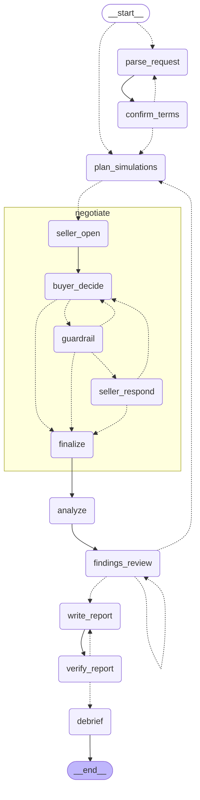

# VBM - Virtual Business Meeting
### הכנה לפגישת רכש באמצעות סימולציית משא ומתן

בעל עסק שנכנס לפגישת רכש לא יודע איפה הספק יעצור, ואיזה ויתור שלו באמת שווה כסף. VBM נותן לו לשחק את הפגישה מראש. הוא כותב בשפה חופשית מה הוא רוצה לקנות ומה הגבולות שלו, והמערכת מריצה 9 משאים ומתנים מדומים במקביל: 3 סגנונות ספק (קשוח, מאוזן, גמיש) מול 3 גרסאות קונה (בסיס, גמישות בתשלום, גמישות במועד). אחר כך הוא עוצר, משנה הנחות ("מה אם אעלה את התקציב?"), ומקבל דוח הכנה: האם אפשר לסגור, באיזה טווח מחירים, על מה כדאי להתגמש ומה מפוצץ את העסקה.

המערכת **מכינה** לפגישה ולא מנהלת אותה: ההחלטה נשארת אצל האדם. לכן כל מספר בדוח מחושב בקוד ונבדק, ובשתי נקודות הגרף עוצר ומחכה לאדם.

---

## עמידה בדרישות הפרויקט

| דרישה | איך היא מתקיימת | איפה בקוד |
|---|---|---|
| 1. שימוש ב-LangGraph | גרף ראשי ותת-גרף של משא ומתן אחד, 9 הרצות מקבילות של תת-הגרף דרך `Send`, ו-checkpointer ששומר את המצב בין העצירות | `src/vbm/infrastructure/workflow/graph.py`, `subgraph.py` |
| 2. לולאה או ענף מותנה | שתי לולאות: סבבי המיקוח בתת-הגרף, ולולאת "מה אם" בגרף הראשי. ענפים מותנים אחרי הקונה, אחרי המעקה, אחרי הספק, אחרי כל עצירה ואחרי אימות הדוח | פונקציות `route_*` ב-`nodes.py` וב-`subgraph.py` |
| 3. interrupt ו-human-in-the-loop | עצירה 1: אישור או תיקון של פענוח הבקשה. עצירה 2: בחירה בין דוח, שינוי עמדה ושינוי הנחות על הספק | `confirm_terms`, `findings_review` ב-`nodes.py` |
| 4. דאטהסט והערכה אוטומטית ב-LangSmith, לפני ואחרי שיפור | 18 תרחישים עם תשובה ידועה, 9 מעריכים בקוד, ניסוי baseline (פעמיים, למדידת הרעש) מול ניסוי אחרי שיפור הפרומפט | `src/vbm/infrastructure/evaluation/evaluators.py`, `scripts/run_experiment.py` |
| 5. README עם צילומי trace ותובנה | שני צילומי trace, צילום של השוואת הניסויים, ותובנה אחת שהובילה לשינוי שנמדד | הקובץ הזה, `docs/images/` |

## הגרף

התרשים מופק מהגרף המהודר עצמו (`python scripts/draw_graph.py`, הפלט ב-`docs/graph.md`), ולכן הוא תמיד תואם לקוד. קו מקווקו הוא ענף מותנה.



- **הזרימה:** `parse_request` (המודל הופך טקסט חופשי לנתונים ורושם את ההנחות שהניח), **עצירה 1**, `plan_simulations`, ‏9 × `negotiate` במקביל, `analyze` (ניתוח בקוד בלבד), **עצירה 2**, `write_report`, `verify_report`, ולבסוף `debrief` (חשיפת הגבולות האמיתיים של הספק).
- **לולאת הסבבים (תת-הגרף):** הספק פותח, הקונה (מודל שפה) מחליט accept, counter או walk_away, המעקה בודק את ההחלטה, והספק המדומה (קוד דטרמיניסטי) עונה. עד 8 סבבים.
- **לולאת "מה אם":** בעצירה 2 המשתמש משנה את העמדה שלו או את ההנחות על הספק, והגרף חוזר ל-`plan_simulations` מול אותו ספק בדיוק. תשובה לא תקינה מחזירה לאותה עצירה.
- **לולאת אימות הדוח:** כל מספר בדוח נבדק מול הנתונים שחושבו בקוד. עד 3 ניסיונות, ואחריהם דוח חלופי שנבנה בקוד.
- **המעקה:** הצעה שחורגת מהתקציב, מהמועד או מתנאי התשלום חוזרת לקונה עם משוב. אחרי 2 כישלונות הקוד מצמיד אותה לערך המותר הקרוב.

## צילומי trace ותובנה

### סימולציה מלאה: הקונה שילם כמעט את כל התקציב

ניסוי `baseline-v1-76e1b75e`, תרחיש seed 4 (‏40 מחשבים ניידים), ספק קשוח, גרסת בסיס:


הקונה פתח ב-**3,500** ליחידה, שהוא מחיר היעד שלו, וסגר אחרי 8 סבבים ב-**3,950**, רק 8.32 מתחת לתקרה ליחידה (3,958.32). מחיר המינימום של הספק היה 3,409.84, כך שהיה מקום לסגור אפילו מתחת ליעד.

### עצירה 2 וחזרה ללולאת "מה אם"

כל המשך אחרי עצירה נרשם ב-LangSmith כ-trace נפרד. בצילום רואים את סוף ה-trace הקודם, שנעצר ב-`findings_review`, ואת ה-trace הבא, שמתחיל באותה עצירה עם התשובה `change_terms` וחוזר ל-`plan_simulations` ול-9 סימולציות חדשות:


### התובנה

- **מה ראיתי:** קראתי את ה-`rationale` של הקונה ב-traces של שלושת התרחישים עם ציון המחיר הנמוך ביותר (seeds 4, 45 ו-32, עם ציונים 0.016, 0.030 ו-0.082). בכולם חזר אותו דפוס: פתיחה ביעד, קפיצה בסבב 2 כמעט עד התקציב ליחידה, וחזרה על ההצעה עד שהספק יורד אליה. **הקונה מתייחס לתקציב המקסימלי כאל יעד, ולא כאל תקרה.**
- **מה שיניתי (prompt v2):** הקוד מוסר לקונה טווח הצעה מותר לכל סבב: פתיחה בין 90% ל-100% מהיעד, וכל ויתור לכל היותר רבע מהפער שנותר. בנוסף נכתב כלל מפורש: "The maximum budget is a hard ceiling, not an offer."
- **מה המדדים הראו:** `mean_price_score` עלה מ-0.287 ל-**0.490**. השיפור, 0.203, גדול פי 47 מהרעש שנמדד בין שתי הרצות ה-baseline. באותו תרחיש v2 סגר ב-3,750 ולא ב-3,950. המחיר: שיעור הסגירה ירד ב-0.045, מעט יותר מהרעש (פירוט בטבלה למטה).

## הערכה ב-LangSmith

- **הדאטהסט `vbm-meeting-prep-18`:** ‏18 תרחישים שנבנו בקוד מ-seeds קבועים, וקפואים ב-`data/dataset.json`. לכל תרחיש ידועה התשובה: האם קיים טווח הסכמה (ZOPA), מה גבולותיו, ומהו הוויתור המכריע. התמהיל: 6 עם טווח רחב, 5 עם טווח צר, 4 בלי טווח במחיר, 3 בלי טווח במועד.
- **המעריכים (כולם בקוד, בלי LLM-as-judge):**

| מעריך | מה הוא מודד |
|---|---|
| `price_score` | איפה בתוך הטווח נסגרה עסקת הבסיס: 1 ברצפה של הספק, 0 בתקרה של הקונה |
| `close_rate` | שיעור הסגירה כשקיים טווח הסכמה |
| `feasibility_correct` | האם המערכת זיהתה נכון אם אפשר לסגור |
| `decisive_concession_correct` | האם הוויתור המכריע בדוח תואם לתשובה האנליטית |
| `budget_violation` | האם עסקה כלשהי עברה את התקציב (צריך להיות תמיד 0) |
| `report_numbers_match` | האם כל המספרים בדוח עברו אימות מול הנתונים |

  ובנוסף שלושה מדדי אבחון: `first_offer_position`, `accepted_opening_rate` ו-`guardrail_hits`.
- **הניסויים:** כל ניסוי הוא 18 תרחישים × 2 חזרות. הספק זהה בכל החזרות (seed קבוע), ולכן הרעש מגיע רק מה-temperature של הקונה (0.7). ה-baseline הורץ פעמיים כדי למדוד את הרעש הזה לפני כל השוואה.

| מדד | baseline א' | baseline ב' | improved-v2 | שינוי מול ממוצע ה-baseline | רעש (א' מול ב') |
|---|---|---|---|---|---|
| mean_price_score | 0.285 | 0.289 | **0.490** | **+0.203** | 0.004 |
| feasibility_accuracy | 1.000 | 0.972 | 0.944 | −0.042 | 0.028 |
| decisive_accuracy | 0.528 | 0.500 | 0.611 | +0.097 | 0.028 |
| mean_close_rate | 0.636 | 0.667 | 0.606 | −0.045 | 0.030 |


**למה זה חשוב גם במוצר אמיתי:** בלי מדידה, "שיפרתי את הפרומפט" הוא תחושה. כאן השינוי נבדק על אותם 18 תרחישים, מול רעש שנמדד מראש, והתברר שהוא משפר את המחיר בבירור אבל עולה מעט בשיעור הסגירה. כך יודעים שהדוח אמין, ויודעים בדיוק מה המחיר של כל שינוי.

## התקנה והרצה

הפרויקט פותח ונבדק על Windows 11 עם Python 3.13.5 (נדרש Python 3.11 ומעלה).

```bash
python -m venv .venv
.venv\Scripts\activate          # Linux/macOS: source .venv/bin/activate
pip install -r requirements.txt
pip install -e .
copy .env.example .env          # then fill in OPENAI_API_KEY and LANGSMITH_API_KEY
```

| מה | פקודה |
|---|---|
| בדיקות (101, בלי קריאות למודל) | `pytest` |
| ממשק גרפי | `streamlit run app/streamlit_app.py` |
| שורת פקודה | `python scripts/run_cli.py --seed 1` |
| Studio | `langgraph dev` (שני גרפים: `vbm_main` ו-`vbm_subgraph`) |
| תרשים הגרף | `python scripts/draw_graph.py` |
| יצירת הדאטהסט | `python scripts/create_dataset.py` |
| הרצת ניסוי | `python scripts/run_experiment.py --prompt-version v1` (ברירת המחדל: v2) |
| השוואת ניסויים | `python scripts/compare_experiments.py <experiment-a> <experiment-b> ...` |
| הנקודות החלשות של ניסוי | `python scripts/inspect_experiment.py <experiment> [--no-deals]` |

## טכנולוגיות וכלים

| כלי | השימוש |
|---|---|
| **LangGraph** | `StateGraph`, תת-גרף כצומת, `Send` להרצה מקבילית, `interrupt` ו-`Command(resume=...)`, `InMemorySaver` |
| **LangChain + OpenAI** | `gpt-4o-mini` בארבעה תפקידים (פענוח, קונה, דוח, תרגום), עם פלט מובנה (`with_structured_output`) |
| **LangSmith** | tracing, דאטהסט, `evaluate` עם מעריכים בקוד, השוואת ניסויים |
| **Pydantic** | סכמות לפלט המובנה של המודל ולבדיקת הקלט |
| **Streamlit** | ממשק בעברית מימין לשמאל, עם שתי העצירות ותמלילים מתורגמים |
| **pytest** | 101 בדיקות, כולל ריצה מלאה של הגרף עם קונה מתוסרט ובדיקת דליפה |

## עקרונות תכנון

- **המודל מחליט ומנסח, הקוד מחשב.** כל מספר (טווח, ממוצעים, פער, ויתור מכריע) מחושב ב-`analysis.py`. המודל רק מנסח את הדוח, והניסוח נבדק מול המספרים.
- **אין דליפה.** הפרומפט של הקונה נבנה רק מנתוני הקונה ומהתמליל. בדיקת pytest מריצה משא ומתן מלא עם מספרים ייחודיים ומוודאת שמחיר המינימום וערכי הרצפה של הספק לא מופיעים באף פרומפט.
- **ספק דטרמיניסטי.** הספק המדומה הוא קוד עם עקומת ויתורים לפי סגנון, ולא מודל שפה. אותו seed נותן אותו ספק, ולכן הניסויים ניתנים להשוואה.
- **הגרף מחזיר נתונים בלבד.** התצוגה (CLI או Streamlit) מאזינה לזרם האירועים, וההערכה רצה על אותו גרף בדיוק, עם מדיניות קבועה בעצירות.

## תקלות שנפתרו בדרך

1. **SSL מול סינון האינטרנט.** Python 3.13 מפעיל כברירת מחדל את `VERIFY_X509_STRICT`, ותעודת הסינון נדחתה, כך שאף קריאה ל-OpenAI או ל-LangSmith לא עברה. הפתרון: קובץ `.pth` בסביבה הווירטואלית שמסיר רק את הדגל הזה. אימות התעודה עצמו נשאר פעיל.
2. **"מה אם" שלא יכול היה לעזור.** בכל חזרה ללולאה הספק הוגרל מחדש לפי מחיר היעד החדש של הקונה, ולכן הפער נשאר זהה. הבדיקות לא תפסו את זה, כי השתמשו בספק קבוע. התיקון: הספק מוגרל פעם אחת ונשמר ב-State, ונוספה בדיקה שמוודאת שהוא לא משתנה לאורך הלולאה.
3. **דוח שמנסח מספרים לא נכונים.** בריצה אמיתית הופיעו "מינימום 2500 ומקסימום 2500", סעיף "מה יסגור את הפער" כשלא היה פער, והמלצה בלי סיבה. התיקון: המשפטים הרגישים ורשימת הסעיפים נבנים בקוד, `verify_report` בודק כל מספר, ואחרי 3 כישלונות מופק דוח חלופי מהנתונים.
4. **Studio שלא נפתח.** השרת של `langgraph dev` העלה את שני הגרפים בלי שגיאה, אבל הדפדפן לא התחבר לכתובת המקומית בגלל חסימת רשת. לכן התרשים מופק ישירות מהגרף המהודר (`draw_graph.py`), בלי רשת.

## מגבלות והמשך

- **פרישה מתחת לתקרה.** ב-v1 וגם ב-v2 הקונה פורש לפעמים בטענה ש"ההצעה חורגת מהתקציב", כשההצעה בפועל מתחת לתקרה ליחידה (למשל seed 39: הצעות של 3,883.04 ו-3,724.80 מול תקרה של 4,254.68). שני תיקונים מוצעים: הקוד יסמן בפרומפט לכל הצעה של הספק אם היא בתוך התקציב, וטווח הוויתור יתרחב לקראת הסבבים האחרונים.
- **v2 נתקע כשהיעד רחוק מתחת לרצפה.** הוויתורים הקטנים מתכנסים לערך שעדיין מתחת לרצפה של הספק. זה מסביר חלק מהירידה בשיעור הסגירה.
- **זיהוי הוויתור המכריע רגיש לרעש.** הכלל (שיפור של יותר מ-1% במחיר הממוצע) מושפע מסימולציה בודדת. הכלל לא שונה, כדי ש-v1 ו-v2 יימדדו על אותה מערכת.
- **הספק מדומה.** הדוח מראה איך המצב מתנהג מול שלושה סגנונות מוגדרים, ולא מבטיח מה יעשה ספק אמיתי.

## מבנה התיקיות

הקוד בנוי לפי clean architecture: ארבע שכבות, וכל import מצביע פנימה בלבד (infrastructure -> adapters -> application -> domain). הלוגיקה העסקית לא מכירה את OpenAI, את LangGraph או את LangSmith, והמודלים מוזרקים לגרף דרך ports.

```
src/vbm/domain/          entities and business rules: schemas, economics, seller_sim, scenario_generator, rules
src/vbm/application/     use cases and ports: analysis, negotiation, meeting_prep, numbers, ports, dto, policy
src/vbm/adapters/        texts (Hebrew/English), prompts/ (buyer_v1, buyer_v2, parser, report, translate), llm_gateways, display
src/vbm/infrastructure/  OpenAI (llm), wiring, settings, reports, workflow/ (LangGraph: graph, subgraph, nodes, state), evaluation/ (LangSmith)
scripts/     run_cli, run_experiment, compare_experiments, inspect_experiment, create_dataset, draw_graph
app/         streamlit_app.py
data/        dataset.json (18 scenarios, frozen)
tests/       101 pytest tests
docs/        decisions.md (all decisions), graph.md, images/
```

> האפיון המלא: `אפיון_הכנה_לפגישת_רכש.docx` | רשימת המשימות: `רשימת_משימות_הכנה_לפגישה.docx` | יומן ההחלטות: `docs/decisions.md`
